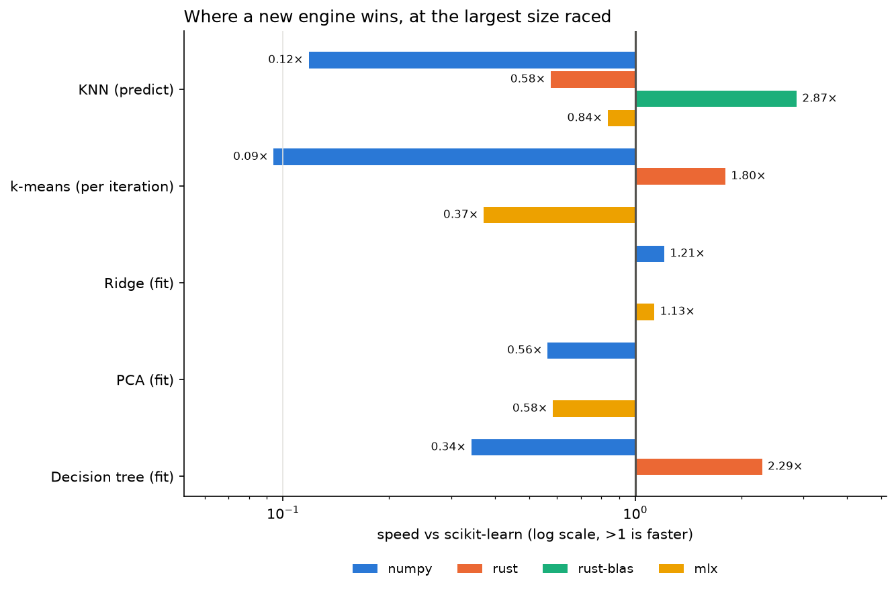

# Where does Rust beat scikit-learn?

**ML in Rust: an experiment.** I built five machine-learning algorithms several ways (plain Python on NumPy, compiled Rust, Rust driving Apple's matrix hardware, and Python on the Apple GPU) and raced them against scikit-learn. Every engine had to match scikit-learn's answers before its time counted.

**Short answer:** compiled Rust wins clearly on three of five algorithms: **2.9 to 4.4×** on k-nearest neighbors, **1.8 to 2.1×** on k-means, and **2.3 to 3.6×** to train a decision tree (**7.4 to 7.9×** to predict). The other two algorithms had no room to win. Plain Python on NumPy lost almost everywhere, and Python on the GPU tied at best. The biggest gap in the whole study wasn't an engine: picking the wrong scikit-learn PCA solver cost **42×**.



*Speed relative to scikit-learn at the largest size raced, Apple M4, macOS. Right of the line is faster. Log scale.*

## The question

Python ML is fast when the work is big matrix math, because NumPy and scikit-learn hand that math to optimized libraries (BLAS). It gets slow when the work is loops, branches and many small calls. So:

1. Which common algorithms still have **headroom**, meaning room for a faster engine?
2. Is plain Python enough to reach it, or does it take compiled code or a GPU?
3. When Rust wins, is that the language, or the hardware it can reach?

## Method

**Five algorithms, chosen to stress different bottlenecks:**

| Algorithm | Main bottleneck | Engines raced against scikit-learn |
|---|---|---|
| k-nearest neighbors | matrix math, then picking the k smallest (memory-bound) | numpy, rust, rust-blas, mlx |
| k-means | matrix math every iteration, plus summing rows per cluster | numpy, rust, mlx |
| Ridge regression | one big matrix multiply, then a tiny solve | numpy, mlx |
| PCA | one big matrix multiply, then a tiny eigen-solve | numpy, mlx |
| Decision tree | branchy integer counting, no matrix math | numpy, rust |

**The engines:**
- `numpy`: Python on top of NumPy, which hands matrix math to its BLAS.
- `rust`: Rust compiled for the machine's CPU, using every core, with Python's GIL released.
- `rust-blas`: the Rust engine, but with the distance math going to a tuned matrix multiply. On macOS that's Apple Accelerate, which can use the chip's matrix units.
- `mlx`: Python on the Apple GPU through MLX.

Ridge and PCA have no Rust engine on purpose: their cost is one multiply that Rust would hand to the same BLAS.

**Rules:**
- **Correctness comes first.** Every engine is tested against scikit-learn: 94 tests covering identical predictions, matching clusters, coefficients within tolerance, and trees that are identical node for node. Ridge is also checked against an exact 64-bit answer.
- **The races are fair.**
  - Same data and same starting points for every engine.
  - k-means is timed per iteration.
  - Times are medians after a warm-up call.
  - scikit-learn runs with its defaults, on all cores.
- **The data is real where possible.** KNN, k-means and the tree use Covertype (581,012 rows, 54 features). Ridge and PCA use synthetic data, because they need controlled sizes up to 4 million rows.

## Results (Apple M4, 10 cores, 24 GB, macOS)

| Algorithm (largest size) | numpy | mlx | rust | rust-blas |
|---|---:|---:|---:|---:|
| KNN, predict 2,000 rows (579k train) | 0.12× | 0.84× | 0.58× | **2.87×** |
| KNN, one row at a time (10k train) | 4.6× | 1.1× | 8.7× | **11.4×** |
| k-means, per iteration (2M rows) | 0.09× | 0.37× | **1.80×** | |
| Ridge, fit (4M rows) | **1.21×** | 1.13× | | |
| PCA, fit (3M rows) | 0.56× | 0.58× | | |
| Decision tree, fit (531k rows, depth 20) | 0.34× | | **2.29×** | |
| Decision tree, predict (50k rows) | 0.68 to 0.79× | | **7.4 to 7.9×** | |

Every size, chart and table is in [`notebooks/`](notebooks/). Start with [`00_start_here`](notebooks/00_start_here.ipynb), or jump to the [summary](notebooks/06_summary.ipynb). The raw numbers are in [`notebooks/results/`](notebooks/results/).

## Findings

1. **Wrapping libraries in Python loses.** The NumPy engines ran 6 to 12× slower than scikit-learn on KNN and k-means. The slow step was always memory-bound work running in Python: picking the k smallest, summing per cluster, or one call per tree node.
2. **Python on the GPU ties at best.** MLX still writes big intermediate matrices to memory and reads them back. A Rust engine scores and selects in one pass instead.
3. **Rust wins where it controls the loop.** It fuses steps together, keeps data in cache, uses every core, and skips Python's per-call overhead. That overhead is why single-row prediction is up to 11× faster, which matters for robots, games and live APIs.
4. **Some algorithms have no headroom.** Ridge and PCA are one big multiply that scikit-learn already sends to the same hardware. scikit-learn's default PCA beat ours by about 2×.
5. **Choosing well beat building fast.** scikit-learn's PCA took 0.13 s with its default solver and 5.6 s with `svd_solver="full"` on the same data (42×). No engine came within 5× of that.

## Surprises along the way

Each of these is now covered by a test.

- **scikit-learn's k-means isn't bit-reproducible.** Across fresh processes, it lands on one of two answers, because its threads add up centroid sums in whatever order they finish. Our engines combine those sums in a fixed order, so they always give the same answer.
- **A fast shortcut quietly lost precision.** The first Ridge engine subtracted the mean *after* multiplying, in 32-bit floats. Its coefficients drifted up to 7× further from the exact answer than scikit-learn's. Centering in chunks and summing in 64-bit fixed it. On 4 million rows, it now lands about 380× closer to the exact answer than scikit-learn does.
- **Prediction was mostly bookkeeping.** The first Rust tree spent 98% of its prediction time sorting inputs into bins. Comparing raw values against stored cut points made it 40× faster.

## Limitations

- So far this is **one machine**: an Apple M4, where scikit-learn has no GPU path. That's the reason for the next step.
- Three of the Rust wins lean on Apple Accelerate. Whether they're Rust wins or Apple wins is open (see below).
- Five algorithms, two datasets, single-node only. scikit-learn's tree-based KNN search wasn't raced, because its default picks brute force for 54 features.
- The NumPy engines are straightforward implementations. A cleverer one could close part of the gap.

## Next: is it Rust, or is it Apple?

The next run is an **Intel Mac running Linux**:
- scikit-learn and NumPy will use OpenBLAS.
- The Rust engines will use a pure-Rust matrix multiply, compiled for that CPU.
- MLX isn't available.

[`PREDICTIONS.md`](PREDICTIONS.md) says what should happen. It was written and committed before the run. My bet is that Rust's matrix-heavy wins shrink, while its wins on trees and single-row latency hold. The [summary notebook](notebooks/06_summary.ipynb) compares the machines as soon as the second results folder lands.

## Reproduce it

You need Python 3.10+, git, a C compiler and Rust ([rustup.rs](https://rustup.rs)).

```bash
git clone https://github.com/herodthegreater/ML-in-rust-experiment.git
cd ML-in-rust-experiment
./run_all.sh
```

`run_all.sh` does the whole job:
- creates `.venv` and installs the dependencies (plus MLX on Apple silicon)
- builds the Rust engines for your CPU
- runs the tests
- executes every notebook

Your numbers go to `notebooks/results/<your-machine>/`. The committed notebooks are never overwritten. `QUICK=1 ./run_all.sh` runs a short version on small data. Covertype (about 11 MB) downloads on first use.

On Debian or Ubuntu, the system packages are:

```bash
sudo apt install python3-venv build-essential git curl
```

To contribute a machine's results, commit the new `notebooks/results/<machine>/` folder.

## Layout

```text
src/                     Rust engines (PyO3): knn.rs, kmeans.rs, tree.rs, gemm.rs (Accelerate or matrixmultiply)
python/ml_in_rust/       scikit-learn-style estimators with a backend= switch
tests/                   94 parity tests against scikit-learn
notebooks/               one notebook per algorithm, plus 00_start_here and 06_summary
notebooks/results/       saved numbers, one folder per machine
docs/                    the scoreboard chart
PREDICTIONS.md           what the second machine should show, written before running it
run_all.sh               build, test and run everything on a new machine
race.py                  a quick one-size KNN race
```

## Where this came from

This started as the first version of [autoalgo](https://github.com/herodthegreater/autoalgo) (tag `speed-study-v0.2`), which was meant to be a faster scikit-learn. These results changed that plan: finding 5 pointed at helping people choose well, not at building faster engines. So autoalgo is now becoming a tool that helps people choose and understand scikit-learn algorithms, and the speed research lives here.

MIT license. See [LICENSE](LICENSE).
